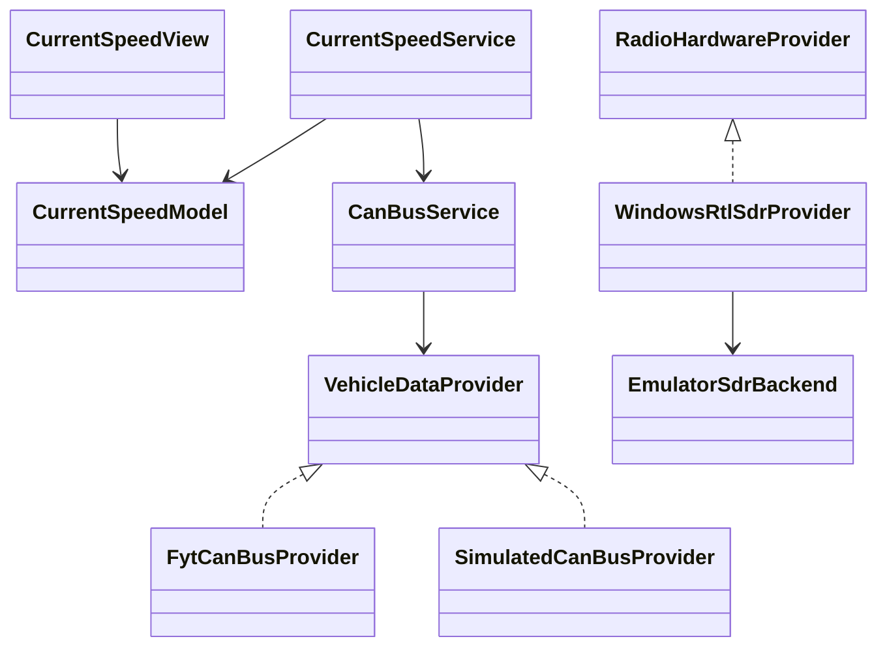
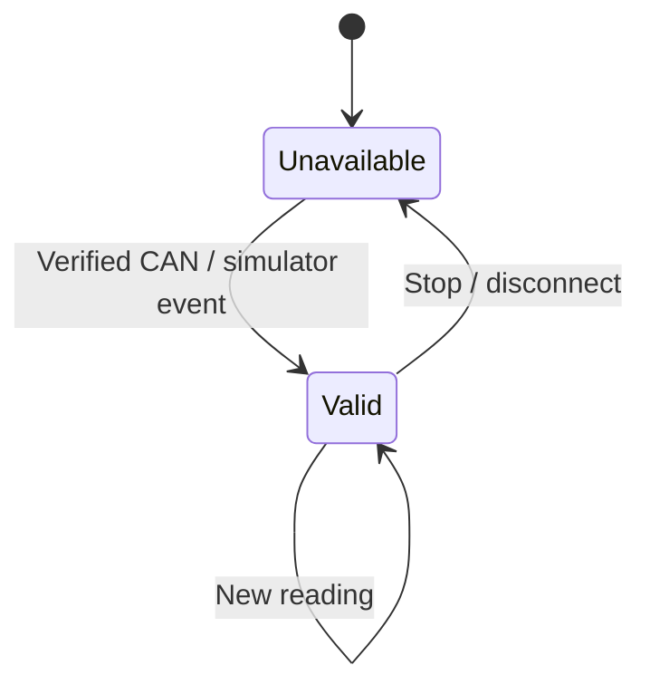

# MONTRIX V28 — source review package

## Status
Design/refactor checkpoint. **Not validated on the car and not build-tested.** No numerical CAN speed decoder is established from the supplied log. Real-car speed deliberately displays unavailable instead of GPS or invented values.

## Architecture

## Speed state machine

## Known limitations
- CAN trace shows `updateCode = 1049` but does not identify the numerical speed payload; FYT provider is deliberately a non-functional placeholder until a verified CAN source is identified.
- Emulator route broadcasts are currently accepted from legacy `SIM_EVENT` path; migrate to a dedicated route provider in a later step.
- Existing radio and music activities remain legacy. RTL-SDR adapter wraps the existing emulator bridge; no Windows RTL-SDR server was included in this change.
- The rest of the UI is not yet fully refactored into per-component View/Model/Service classes.
- Changing applicationId creates a separate Android installation; old broadcast action is temporarily retained for legacy emulator compatibility.
- V28 requires architecture tests, unit tests, Gradle build and actual CAN verification before deployment.
